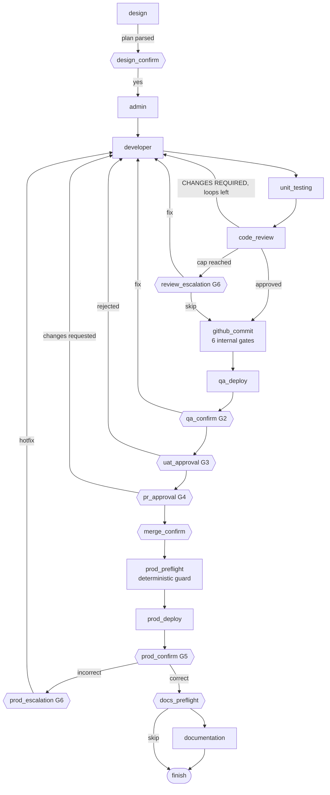

# Architecture

Maps the "LangGraph + CATS architecture" diagram onto this repo. Lane numbers follow the diagram.

| Lane | Component | Code |
|---|---|---|
| 1 | Browser dashboard | `frontend/` (built into `sdlc_orbit/static`) |
| 2 | API backend (thin HTTP, no agent logic) | `sdlc_orbit/api/main.py` |
| 2 | Postgres: app tables + LangGraph checkpoints | `migrations/001_init.sql`, `sdlc_orbit/db.py`, `AsyncPostgresSaver` |
| 3 | Supervisor StateGraph | `sdlc_orbit/graph.py` |
| 3 | LLM endpoint | `sdlc_orbit/llm.py` (Anthropic) |
| 4 | MCP toolkit servers | `toolkits/*`, client in `sdlc_orbit/mcp_tools.py` |

Source of truth for progress is the **checkpoint**; `pipeline_sessions`, `agent_turns` are projections for the UI
and `gate_log` is the audit trail.

## Flow

Diamonds are human gates. Every node can also open a `limit` (tool-call budget) or `tools_unavailable` gate; any
outcome gate re-asks on unrecognised input.

## Node contract

- An **agent node** runs one turn (`runtime.run_turn`): model call, sequential tool calls, repeat until the
  model answers without a tool call. For the four gate-capable agents, a reply that looks like a gate
  (`gates.looks_like_gate`) opens a gate; otherwise the turn is a result.
- A **gate** is recorded in `gate_log`, then the node returns and the router sends the run to `gate_wait`.
  `gate_wait` only calls `interrupt()`. LangGraph re-executes an interrupted node from its start on resume, so
  keeping it free of LLM and tool calls means nothing runs twice.
- The API stamps the answer (`gate_log.answered_by`) and resumes with
  `Command(resume={text, answered_by, gate_id, source})`. `gate_wait` rejects anything else, then the router
  returns to the node in `resume_node`, which consumes `gate_answer`.
- Threads: each agent has its own message thread in state (the equivalent of one Cortex session). Commit and
  devops threads are per run (`github_commit#2`, `devops_qa#1`, `devops_prod#1`) so a re-run starts clean; design,
  admin, developer, unit-testing, review and documentation continue one thread.
- Context: each agent's system prompt ends with a `SESSION CONTEXT` block (session id, plus the outputs listed in
  `agents.CONTEXT_POLICY`). It goes in the system prompt, not the human turn, so the commit agent's "reject
  pre-supplied values" screening still sees only a one-line goal.

## Deliberate differences from the Cortex-era pipeline

1. **Design confirmation gate restored.** The orchestrator prompt specified "Proceed? (yes / no / changes)", but
   the Python port auto-accepted plans. Disable with `ORBIT_REQUIRE_DESIGN_CONFIRMATION=false`.
2. **Genuine clarifying questions from the design agent are honoured** instead of being overridden by the
   "produce a plan" retry nudge.
3. **Order follows the diagram**: commit/PR before the QA deploy; documentation last; Prod behind G2-G4 + merge.
4. **Automatic review rework** (capped) replaces the immediate human `[F]/[S]/[C]` prompt; the human gate (G6)
   appears only when the cap is reached.
5. **Agents see earlier agents' output** (previously isolated sessions).
6. **Outcome detection**: a commit reported FAILED/CANCELLED, or a deploy reported FAILED/BLOCKED/CANCELLED, stops
   at a human gate instead of silently continuing.
7. **Stricter code-review verdict parsing** (prefers the `Verdict:` line; unknown fails closed).
8. **Gate detection limited** to the agents that can gate.
9. **Tool visibility**: tool-call progress is stored (`role='activity'`) and streamed as `activity` events.

## LLM endpoint

Anthropic, via `langchain-anthropic` (`sdlc_orbit/llm.py`). Defaults: `claude-opus-5-5` (opus tier) and
`claude-sonnet-5-5` (sonnet tier). Thinking blocks are tied to the model and the conversation, so an agent's thread
must stay on one model; each tier is fixed per deployment. `temperature` is opt-in.
